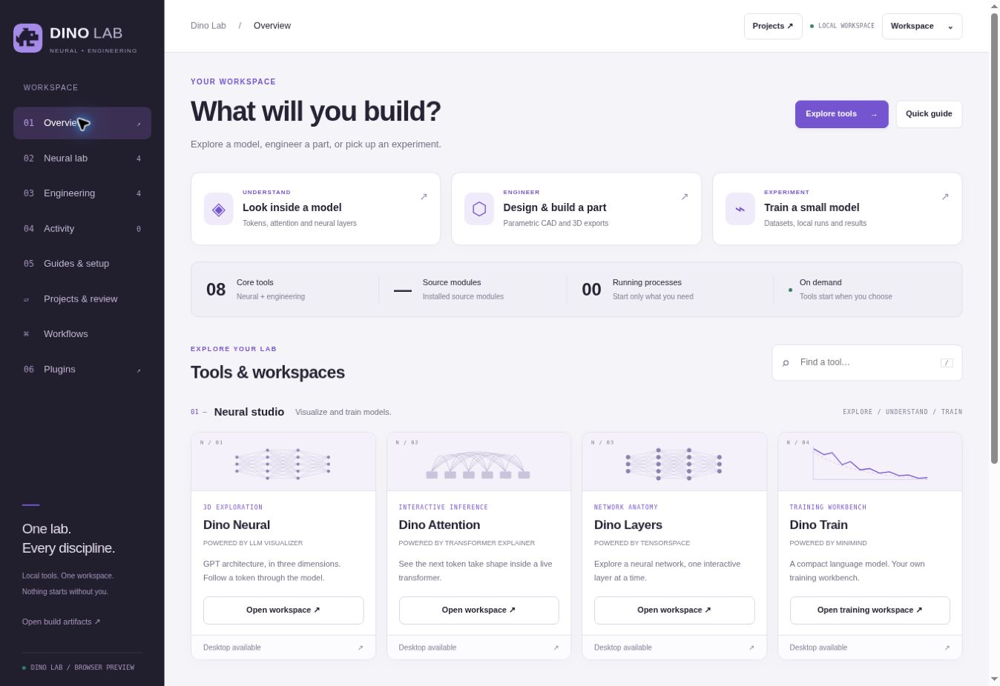
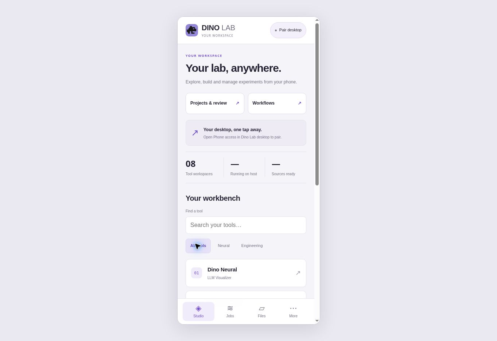

# Dino Lab workspace update

The desktop and browser companion now use silver surfaces, Dino violet accents,
compact typography and consistent controls. One product covers the neural and
engineering tracks.

## Organization

- Overview provides direct entries to neural inspection, CAD and training.
- Neural lab and Engineering show their own tools instead of scrolling through
  the entire application. Activity and Guides have dedicated sections.
- Projects & review and Workflows have direct navigation entries.
- The phone companion puts projects and workflows above the tool list, adds
  search and category filters, and retains its bottom navigation.
- Project settings, model review, agent requests and queue activity are grouped
  into responsive panels. Integration tools use the same visual language.

## Verification

`npm run build:viewer` and all 27 existing `npm test` checks pass. Browser QA checks
section navigation, search, tool dialogs, guides, phone category/search filtering,
and narrow-screen rendering. The preview uses the actual application frontend;
local process controls require the desktop host and are not simulated.

Fusion and FreeCAD native execution, macOS app launch and physical iOS/Android
pairing have not been tested in this Linux session. This update changes their
interface rather than claiming new native integration coverage.

## Interface previews

